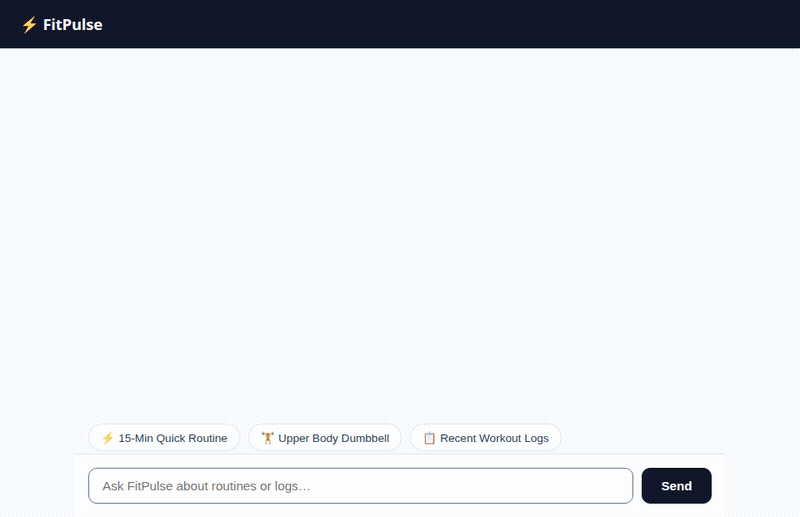

# ⚡ FitPulse — Daily Quick-Fitness & Home Routine Assistant

FitPulse is an AI-powered conversational fitness assistant designed for busy individuals who want effective, fast 15–30 minute home workouts without complicated equipment. Built with Google's Agent Development Kit (ADK) and Gemini 3.8 Flash, FitPulse retrieves structured workout routines, renders interactive cards using A2UI, and logs workout history directly into Cloud Firestore.

<div align="center">
  
</div>

---

## 🌟 Implemented Capabilities & Cloud Services

Based on the codebase in this repository, here is what is actually implemented and wired up:

| Feature / Service | Status | Description in Code |
|---|---|---|
| **Gemini 3.8 Flash (`gemini-3.8-flash`)** | ✅ **Implemented** | Serves as the primary LLM reasoning engine in `app/agent.py`. |
| **A2UI Interactive UI Cards (v0.8)** | ✅ **Implemented** | Generated using `A2uiSchemaManager` and `BasicCatalog`. The `a2ui_callback` hook intercepts model output and serves rich, structured A2UI cards (`Card`, `Column`, `Row`, `Text`, `Image`) rendered directly by the chat frontend. |
| **Cloud Firestore Backend** | ✅ **Implemented** | Database backend for routines and completed workout history in `app/firestore_tools.py`: <br/> • `search_workout_routines`: Queries seeded routines by target area, equipment, duration, and difficulty. <br/> • `log_completed_workout`: Logs completed sessions with perceived exertion rating and notes. <br/> • `get_recent_workout_logs`: Retrieves recent user workout history. |
| **Public Cloud Storage Bucket** | ✅ **Implemented** | Configured Google Cloud Storage bucket (`gs://fitpulse-assets-...`) with public object read access for hosting and serving workout assets and visual badges. |
| **FastAPI + A2A Web Chat Frontend** | ✅ **Implemented** | Minimal FastAPI proxy in `frontend/main.py` communicating with the agent via the A2A protocol, and an HTML/JS chat client (`frontend/static/index.html`) supporting A2UI rendering and prompt suggestions. |
| **Utility Tools** | ✅ **Implemented** | `get_weather` and `get_current_time` function tools in `app/agent.py`. |
| **Memory Bank (Vertex AI)** | ⏳ *Planned, not yet implemented* | Long-term cross-session memory bank configuration. |
| **Image Generation / Code Execution Sandbox** | ⏳ *Planned, not yet implemented* | On-demand image generation (e.g. celebration badges) and code sandbox execution. |

---

## 🏗️ Architecture

```
User (Browser) 
      │
      ▼
FastAPI Proxy (`frontend/main.py`)
      │  (A2A Protocol / JSON-RPC over HTTP)
      ▼
Vertex AI Agent Runtime (`app/agent.py`)
      ├── Gemini 3.8 Flash (ADK Agent Loop)
      ├── A2UI Schema & Callback (`a2ui_utils.py`)
      └── Firestore Tools (`app/firestore_tools.py`)
            │
            ▼
      Google Cloud Firestore (`(default)` database)
        ├── `routines` collection (seeded workouts)
        └── `workout_logs` collection (user workout logs)
```

---

## 🚀 Running the Project Locally

### 1. Prerequisites
- Python 3.11+
- Google Cloud SDK (`gcloud`) authenticated to your Google Cloud project:
  ```bash
  gcloud auth application-default login
  gcloud config set project <YOUR_PROJECT_ID>
  ```

### 2. Set Up the Agent
1. Navigate into the project folder:
   ```bash
   cd fitpulse
   ```
2. Create and activate a virtual environment:
   ```bash
   python3 -m venv .venv
   source .venv/bin/activate
   ```
3. Install dependencies:
   ```bash
   pip install -e .
   ```
4. Seed the Firestore routines collection:
   ```bash
   python seed_firestore.py
   ```
5. Test the agent via ADK web playground:
   ```bash
   adk web app
   ```

### 3. Run the Frontend Locally
1. In a separate terminal, navigate to the `frontend` directory:
   ```bash
   cd fitpulse/frontend
   ```
2. Install frontend requirements:
   ```bash
   pip install -r requirements.txt
   ```
3. Set the required environment variables:
   ```bash
   export AGENT_ENGINE_RESOURCE_NAME="projects/<PROJECT_NUMBER>/locations/<REGION>/reasoningEngines/<ENGINE_ID>"
   export AGENT_DIRECTORY="app"
   ```
4. Start the FastAPI server:
   ```bash
   python main.py
   ```
5. Open your web browser to the local server address indicated in the terminal (default port 8080) to interact with FitPulse.

---

## 📁 Repository Structure

```text
fitpulse/
├── app/
│   ├── agent.py               # Main ADK Agent definition & tool binding
│   ├── firestore_tools.py     # Firestore workout catalog and logging tools
│   ├── a2ui_utils.py          # A2UI callback transformer for A2A data parts
│   ├── a2ui_instruction.py    # Generated A2UI system instructions
│   └── fast_api_app.py        # ADK FastAPI application entrypoint
├── frontend/
│   ├── main.py                # FastAPI proxy translating chat requests to A2A
│   ├── requirements.txt       # Frontend proxy dependencies
│   └── static/
│       └── index.html         # FitPulse chat interface with native A2UI renderer
├── agents-cli-manifest.yaml   # Agent metadata and runtime deployment specs
├── pyproject.toml             # Python package dependencies & ADK configuration
├── seed_firestore.py          # Script to seed initial workout routines
├── demo.gif                   # Looping preview recording of the agent in action
└── README.md                  # Project documentation
```
